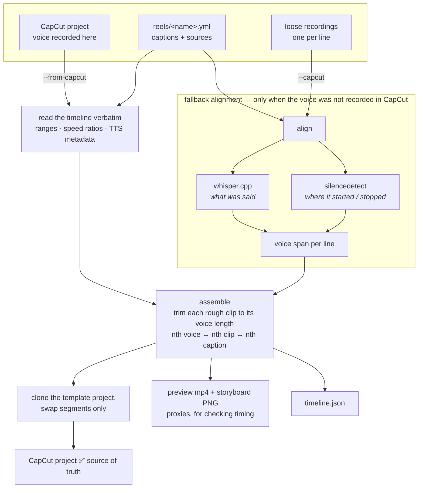

# broll

Edit reels in CapCut faster without leaving CapCut. 한국어: [README.ko.md](README.ko.md).

You record the voice in CapCut and drop in rough clips. broll lines the clips and captions
up to the voice, then hands back a real CapCut project, styled like one of your own, so you
can add music and export. It never renders the final video and never invents a style.

What you get:

- **`broll build`**: trims each rough clip to the length of its voice line and lays the
  captions on top. You get a new CapCut project, plus a preview mp4 and a storyboard to
  check timing.
- **`broll caption`**: transcribes what the edited timeline actually says and lays it down
  as short caption lines. The captions are styled like any project you pick.
- **Python helpers for one-off edits** to CapCut projects that keep the files consistent.
  Most edits after the first pass are one-offs, such as a translated caption layer or making
  every cut the same length.

If you came for how CapCut stores its projects rather than for the tool,
[**docs/capcut-draft-format.md**](docs/capcut-draft-format.md) is a standalone write-up of
the format and the things that break a writer.

## Install

You need macOS, CapCut desktop 9.x and Python 3.11+.

```bash
brew install ffmpeg-full whisper-cpp
uv tool install git+https://github.com/june1ee/b-roll     # or: pipx install git+https://github.com/june1ee/b-roll

# whisper model, only needed for `caption` and for voice recorded outside CapCut
mkdir -p ~/.cache/broll/models
curl -L --fail -o ~/.cache/broll/models/ggml-large-v3-turbo.bin \
  https://huggingface.co/ggerganov/whisper.cpp/resolve/main/ggml-large-v3-turbo.bin
```

`ffmpeg-full` is keg-only, so it is not on `PATH`. broll finds it anyway. The default
ffmpeg bottle has no libass, so it cannot burn captions into the preview.

## Quick start

CapCut projects are referred to by the name shown in CapCut's project list. A full folder
path works too.

### 1. Make a style template once

Make a CapCut project that looks the way you want: at least one video clip and one caption.
broll copies fonts, sizes, strokes, shadows, positions, animations and voice speed from it
segment by segment, so **a format is just a CapCut project**. A caption that looks like
`7:30` becomes the clock layer, one that starts with `(` becomes the aside layer, and
anything else is the main caption.

### 2. Voice-first reel: `build`

In a CapCut project, for example `my-reel`:

1. Record the voice **one take per line**, or generate TTS, and set its speed.
2. Put **one rough clip per line** on the video track in the same order, each a little
   longer than its line.
3. Add the captions in CapCut, or write them in a yml (step 4).

```bash
broll build --from-capcut my-reel                      # captions are already in CapCut
broll init my-reel                                     # or: write reels/my-reel.yml from the recordings,
broll build reels/my-reel.yml --from-capcut my-reel    #     fill in t: per line, then build
```

The nth voice segment pairs with the nth clip and the nth caption. If the counts do not
match, broll stops with an error instead of misaligning them. The result is a new project,
`my-reel-broll`. CapCut lists it within a few seconds. The style comes from `template:` in
the yml, or from `my-reel` itself.

### 3. Captions for a talking head or vlog: `caption`

```bash
broll caption my-take --style my-template --dry-run    # print the lines, write nothing
broll caption my-take --style my-template              # writes my-take-caption
broll caption my-take --style my-template --lang en --max-chars 32
```

broll rebuilds the audio exactly as the timeline plays it, using only the kept cuts at their
speed, and transcribes it once. Every caption is therefore something the viewer hears. Lines
break first at sentence ends and pauses. Line-by-line recordings also break between
recordings. Long runs are then split under `--max-chars`. Expect to fix the odd misheard word
in CapCut.

The defaults (`--lang ko`, 16 characters, breaks at Korean clause endings) are tuned for
Korean. For other languages, pass `--lang` and a longer `--max-chars`.

### Voice recorded somewhere else

```bash
broll build reels/my-reel.yml --capcut my-reel-out
```

Give each line a `rec:` file. broll finds the spoken part with whisper and silence detection
and applies the template's voice speed. See [reels/example.yml](reels/example.yml) for every
field.

### Outputs

The build files go in `reels/.broll/<name>/`, next to the yml or under `./reels` when there
is none:

- `timeline.json`
- a storyboard PNG with per-cut warnings drawn on it
- the preview mp4

## One-off edits from Python

Most changes after the first pass are specific to one reel. In practice these included an
English caption layer under the Korean one, every cut set to the same length, and one
animation copied to every amount caption. They are short scripts on top of
`broll.capcut`:

```python
import copy
from broll import capcut as cc

raw = cc.load_raw("my-reel")
mats = cc.index_materials(raw["materials"])

def animations(seg):
    return next(m for r in seg["extra_material_refs"]
                for kind, m in [mats.get(r, ("", {}))] if kind == "material_animations")

track = next(t for t in raw["tracks"] if t["type"] == "text")
first, *rest = sorted(track["segments"], key=lambda s: s["target_timerange"]["start"])
for seg in rest:
    # keep each animation's id as is: it names the effect, it is not an instance id
    animations(seg)["animations"] = copy.deepcopy(animations(first)["animations"])

cc.save_in_place("my-reel", raw)        # refuses while the project is open in CapCut
print(cc.validate_draft("my-reel") or "ok")
```

| Helper | What it does |
|---|---|
| `load_raw` / `save_in_place` | Read and write the timeline. Writes both copies of the document and updates the project metadata |
| `copy_project` | Copy a project before editing it |
| `prototypes` | Pick a sample segment and material of each kind (video, caption layers, voice) to clone |
| `clone_extras` | Give a cloned segment its own speed, canvas and animation materials. Shared ones stop playback |
| `new_id`, `u16len` | A fresh id. A caption length counted the way CapCut counts it |
| `validate_draft` | Check the invariants below |
| `is_open` | Whether CapCut currently has the project open |

## Why it works this way

**It never recreates your styling.** Trying to reproduce CapCut's fonts, strokes, shadows and
positions in code failed on every axis when measured against a real project. Cloning a
template's segments gets them right for free, and there are no style values in the code.

**Timing is read, not guessed.** With `--from-capcut`, the voice track is carried over
verbatim: source ranges, speed ratios and TTS voice metadata. Nothing is inferred, so
there is no alignment error.

**Alignment uses two signals, and only in the fallback mode.** In measurements,
whisper.cpp's timestamps drifted 0.3-1.3 s at the boundaries. So *what was said* comes from
whisper, and *where it started and stopped* comes from `silencedetect`.

**Captions are the spoken words, trimmed.** In 16 real recordings, the captions said what
was spoken, but with endings shortened, filler dropped, and sometimes one take split over
two lines. That breaks exact text matching, so the voice span is tightened from the text
only when the match is strong. Otherwise the whole take is used.

**The preview is a proxy.** Burned-in captions approximate CapCut's text engine through
libass. Colour emoji are dropped from the preview, and `*emphasis*` is coloured only there.
The CapCut project is the source of truth.



## What the writer checks after every build

Each of these is a failure that actually happened:

| Invariant | Symptom when broken |
|---|---|
| Extra materials owned per segment | CapCut preview will not play |
| `draft_info.id` == `main_timeline_id` == `Timelines/<id>/` | Empty second tab, player stuck at 00:00:00:00 |
| Root and sub timeline documents in sync | CapCut opens stale content |
| Video track contiguous | Black frames between cuts |
| Caption style range counted in UTF-16 | Emoji lines render oversized and shift |
| Referenced media exists | Missing-media errors in CapCut |

## Limits

- **Tested only on macOS with CapCut 9.1 to 9.4.** A CapCut update can change the format.
  On another platform, point `BROLL_CAPCUT_DRAFTS` at the drafts folder. That has not been
  tried.
- **Close a project in CapCut before broll edits it in place.** CapCut saves over the file
  when it closes. Commands that write a copy are safe while it is open, but they miss edits
  CapCut has not saved yet. broll warns when that happens.

## Settings

| Environment variable | Default |
|---|---|
| `BROLL_CAPCUT_DRAFTS` | `~/Movies/CapCut/User Data/Projects/com.lveditor.draft` |
| `BROLL_FFMPEG_DIR` | Homebrew's `ffmpeg-full`, then `PATH` |
| `BROLL_MODEL_DIR` / `BROLL_WHISPER_MODEL` | `~/.cache/broll/models` / `ggml-large-v3-turbo.bin` |
| `BROLL_CACHE_DIR`, `BROLL_WAV_DIR`, `BROLL_CLIP_DIR` | under `~/.cache/broll/` |

## Development

```bash
git clone https://github.com/june1ee/b-roll && cd b-roll
uv run broll --help
uv run --with pytest pytest
```

If something differs on your CapCut version, an issue with the version number and the
relevant JSON fragment is very welcome.
